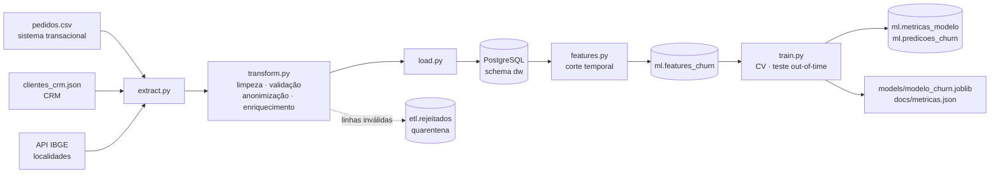
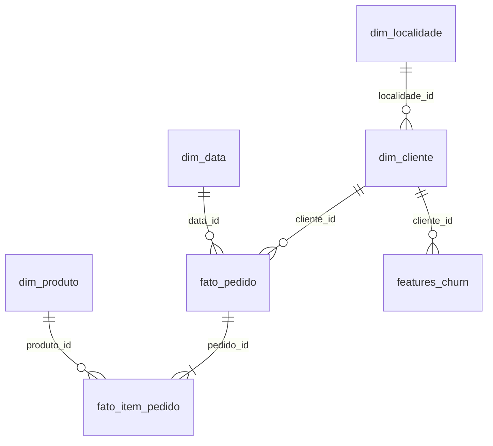

# Projeto Integrador — Pipeline de Engenharia de Dados e Machine Learning

**Previsão de churn de clientes de e-commerce** · MBA em IA — Banco de Dados para Engenharia de Dados (BDED-2026.1)

Pipeline end-to-end: **3 fontes → ETL em Python → PostgreSQL (modelagem em estrela) → features → classificação → métricas**.

> **Pergunta de negócio:** entre os clientes ativos hoje, quais **não vão comprar nos próximos 90 dias**?
> A resposta serve para direcionar ações de retenção (cupom, contato) a quem realmente está em risco.

## Resultado em uma tabela

Avaliação em **corte futuro** (30/09/2025), nunca visto no treino — 2.187 clientes, 30% de churn:

| Modelo | Accuracy | F1 | ROC-AUC |
|---|---|---|---|
| Baseline (sempre "ficou") | 0,700 | 0,000 | 0,500 |
| Regressão logística | 0,804 | 0,624 | 0,828 |
| Random Forest | 0,797 | 0,604 | 0,827 |
| **Gradient Boosting (selecionado)** | 0,792 | 0,604 | 0,818 |

Modelo selecionado com limiar de decisão 0,34 (escolhido só com dados de treino): **Accuracy 0,774 · Precision 0,622 · Recall 0,632 · F1 0,627 · ROC-AUC 0,818**.
Ordenando os clientes por risco, os **20% mais arriscados** têm 73,5% de churn real (média da base: 30%) e concentram 48,9% de todos os churners.

Os números são **modestos de propósito**: o alvo é medido no futuro e não há vazamento de dados. Os três modelos ficam estatisticamente empatados na validação cruzada (F1 ≈ 0,59–0,60 ± 0,024). A seleção seguiu a regra definida antes de olhar o teste (maior F1 médio na CV), e a regressão logística foi marginalmente melhor no teste — o relatório discute isso abertamente (seção 2.7 do notebook).

## Arquitetura



### Modelagem no PostgreSQL ([sql/01_schema.sql](sql/01_schema.sql))



* **`dw`** — Data Warehouse em estrela: `dim_localidade` (IBGE), `dim_cliente` (CRM), `dim_produto`, `dim_data`, `fato_pedido`, `fato_item_pedido`. Com PKs, FKs, `CHECK`s e índices nas chaves de junção.
* **`etl`** — controle operacional: `execucoes` (auditoria de cada run) e `rejeitados` (quarentena com o motivo e o registro original em JSONB).
* **`ml`** — `features_churn` (chave `cliente_id + data_corte`), `metricas_modelo`, `predicoes_churn`.

## As três fontes

| # | Fonte | Formato | Papel |
|---|---|---|---|
| 1 | `data/raw/pedidos.csv` | CSV (72 mil linhas, nível item) | transações → `fato_pedido`, `fato_item_pedido`, `dim_produto` |
| 2 | `data/raw/clientes_crm.json` | JSON (3,2 mil registros) | cadastro → `dim_cliente` |
| 3 | API IBGE `/localidades/municipios` | REST/JSON (5.571 municípios) | enriquecimento → `dim_localidade` (região, UF, meso/microrregião) |

As fontes 1 e 2 são **sintéticas** (geradas por [src/generate_data.py](src/generate_data.py) com semente fixa — não há dados reais de clientes no repositório). Saem **propositalmente sujas** (duplicatas, clientes órfãos, datas inválidas, formatos mistos, quantidades negativas, e-mails ausentes, registros duplicados no CRM…), o que dá trabalho real ao ETL. O churn **não é escrito em nenhum arquivo**: é derivado do histórico de compras. O JSON da API do IBGE fica em cache local, então o pipeline também roda offline depois do primeiro download.

## ETL (`src/`)

| Módulo | Responsabilidade |
|---|---|
| [extract.py](src/extract.py) | lê as 3 fontes sem aplicar regra de negócio |
| [transform.py](src/transform.py) | tipagem, padronização (caixa/acentos/espaços), deduplicação, regras de qualidade, anonimização do e-mail (SHA-256), *join* com o IBGE por (município normalizado, UF) |
| [load.py](src/load.py) | cria banco/esquema, carrega o DW, registra execução e quarentena |
| [etl.py](src/etl.py) | orquestra E → T → L |

Decisões técnicas:

* **Nada é descartado em silêncio.** Linha que viola regra vai para `etl.rejeitados` com o motivo. Se um item de um pedido é inválido, o **pedido inteiro** vai para a quarentena (manter só parte dos itens subestimaria o valor do pedido).
* **LGPD:** só o hash do e-mail chega ao DW; nome/e-mail em claro não são persistidos.
* **Cliente sem município no IBGE** (ex.: cidade inexistente) fica com localidade nula em vez de ser descartado.
* **Carga com *full refresh*** (recria os schemas): simples e idempotente; carga incremental ficaria como evolução.

## Features e alvo (sem vazamento de dados)

Para uma data de corte **T**: a população é a **base ativa** (comprou nos 180 dias antes de T); as features usam **só pedidos ≤ T**; o alvo `churn = 1` se **não houve compra válida em (T, T+90 dias]**. Pedido cancelado não conta como compra. As 23 features (RFM, ritmo/tendência, experiência, perfil) estão documentadas no [notebook](notebooks/Projeto_Integrador_Final.ipynb) (seção 2.2) e em [src/features.py](src/features.py).

* **Treino:** cortes 31/03/2025 e 30/06/2025 · **Teste (out-of-time):** corte 30/09/2025.
* **Validação cruzada:** `GroupKFold` por cliente (o mesmo cliente aparece em mais de um corte).
* **Pré-processamento dentro do `Pipeline`:** imputação por mediana + indicador de ausência, `StandardScaler`, `OneHotEncoder` — ajustado só no treino de cada dobra.
* **Limiar de decisão:** escolhido com predições *out-of-fold* do treino; o teste só é usado no final.
* **Garantia contra vazamento:** teste automatizado e checagem no notebook provam que apagar o futuro dos pedidos **não altera** as features.

> No M5/P14 o alvo era `dias_sem_comprar > 90` e essa mesma coluna entrava como feature (vazamento). Aqui foi corrigido: alvo no futuro, features no passado.

## Estrutura do repositório

```
.
├── README.md
├── requirements.txt
├── .env.example               # modelo de configuração (o .env real não vai para o Git)
├── docker-compose.yml         # PostgreSQL opcional em container
├── build_notebooks.py         # gera/executa os notebooks a partir de células em código
├── sql/
│   ├── 01_schema.sql          # DDL do dw / etl / ml
│   └── 02_consultas_analiticas.sql
├── src/
│   ├── config.py              # caminhos, conexão e parâmetros do experimento
│   ├── generate_data.py       # gera pedidos.csv e clientes_crm.json
│   ├── extract.py · transform.py · load.py · etl.py
│   ├── features.py            # engenharia de features + alvo
│   ├── train.py               # CV, seleção, avaliação, gráficos, persistência
│   └── run_pipeline.py        # executa tudo
├── tests/test_pipeline.py     # 16 testes (regras do ETL e ausência de vazamento)
├── notebooks/
│   ├── 01_analise_exploratoria.ipynb
│   ├── 02_features_modelagem.ipynb
│   └── Projeto_Integrador_Final.ipynb   # notebook final (EDA + features + modelo), executado
├── models/modelo_churn.joblib # modelo treinado (gerado pelo pipeline)
├── data/raw/                  # fontes geradas / cache do IBGE (não versionadas)
└── docs/
    ├── metricas.json          # métricas completas do último treino
    └── figuras/               # gráficos da EDA e da avaliação
```

## Como executar

**Pré-requisitos:** Python 3.10+ e um PostgreSQL acessível. Testado apenas com Python 3.14, PostgreSQL 16, pandas 3, scikit-learn 1.9. O primeiro run precisa de internet (API do IBGE).

```bash
# 1) dependências
python -m venv .venv && source .venv/bin/activate      # Windows: .venv\Scripts\activate
pip install -r requirements.txt

# 2) credenciais do PostgreSQL
cp .env.example .env        # edite POSTGRES_PASSWORD (e host/porta, se for o caso)
#    Sem PostgreSQL local?  docker compose up -d   (usa as mesmas variáveis do .env; compose não testado nesta máquina)

# 3) pipeline completo: gera fontes, ETL, features, treino, avaliação (~1,5 min)
python -m src.run_pipeline
```

O banco `projeto_integrador` é criado automaticamente. Opções: `--skip-generate` (reaproveita `data/raw`) e `--baixar-ibge` (força novo download).

```bash
# 4) testes (não precisam de banco)
pytest -q

# 5) notebooks (leem do PostgreSQL, então rode depois do passo 3)
jupyter lab notebooks/Projeto_Integrador_Final.ipynb
python build_notebooks.py --execute     # opcional: regenera e reexecuta todos

# 6) consultas analíticas
psql -d projeto_integrador -f sql/02_consultas_analiticas.sql
```

**Reprodutibilidade verificada:** duas execuções completas produzem arquivos de fonte e `docs/metricas.json` byte a byte idênticos (semente fixa, ordenação canônica das linhas).

## Limitações e próximos passos

* **Dados sintéticos:** a dificuldade do problema e a importância das features refletem o processo gerador, não um negócio real. Resultados em dados reais podem diferir bastante.
* **Atributos do CRM são o estado atual**, não o histórico em T (ex.: `segmento`). Em produção seria preciso versionar o cadastro (SCD tipo 2) para evitar vazamento sutil.
* **Um único corte de teste:** não se estimou a variabilidade da métrica entre vários cortes futuros (*rolling origin*).
* Sem ajuste de hiperparâmetros (modelo "simples", conforme o enunciado) nem calibração de probabilidades.
* **Próximos passos:** carga incremental, agendamento (Airflow/cron), limiar otimizado pelo custo real de retenção, monitoramento de *drift*.

## Checklist do enunciado

- [x] ≥ 2 fontes de dados (CSV + JSON + API REST)
- [x] Dados modelados e armazenados no PostgreSQL
- [x] ETL em Python
- [x] Features preparadas e documentadas
- [x] Modelo de classificação treinado
- [x] Métricas apresentadas (Accuracy, Precision, Recall, F1, ROC-AUC, PR-AUC)
- [x] Notebook de análise exploratória
- [x] README com instruções
- [ ] Repositório Git acessível — pendente: criar o repositório remoto e fazer o push
- [ ] Notebook final anexado no Moodle — `notebooks/Projeto_Integrador_Final.ipynb`
